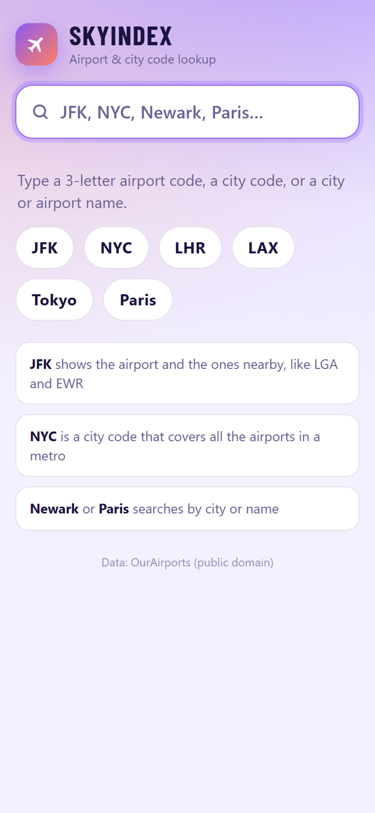
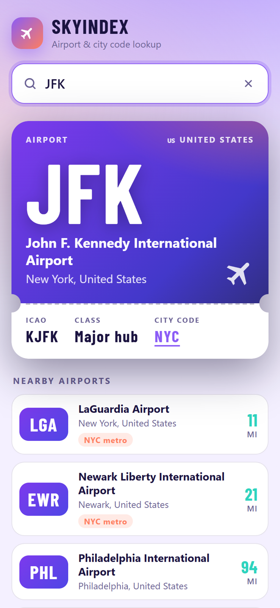
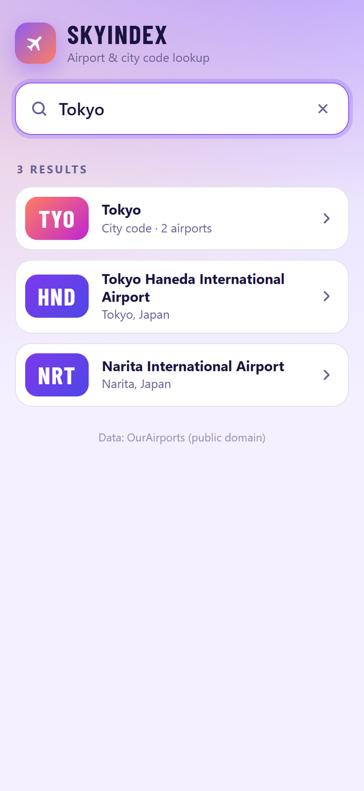

# SkyIndex

A lightweight airport and city code lookup tool I built with Claude Code.

## Why I made it

One of my favorite hobbies is to keep up with the points, miles, and travel space. When you get deeper into the hobby you find yourself searching for flights to and from different destinations pretty often in an attempt to put a good travel route itinerary together. When you're searching for award flights or discounted fares, the more flexible you are, the better your odds are of finding availability. That means being flexible on the dates you're willing to fly out on and flexible on the locations you're willing to depart from and arrive at.

Award search tools, while extremely helpful, sometimes aren't very user-friendly. They often show a list of airport codes without telling you where they are. You can Google each one, but when you're running tens or hundreds of searches, that gets slow. SkyIndex is a lookup tool I use to get quick airport code data to better piece itineraries together.

## What it does

- Search by airport code, city code, city, or airport name.
- Shows nearby airports, hand-picked for big metros.
- Works offline and lives on my phone as a web app.

  
  
  

## Tech stack

- App: Plain JavaScript, no build step
- Data: OurAirports, public domain
- App shell: PWA, manifest and service worker
- Hosting: Cloudflare Pages

## Building it with Claude

A one-off idea became a working app in minutes. After having Claude create the basic functionality of the app I was able to change the different design elements as well as add a few quality of life features to make the app smoother.
